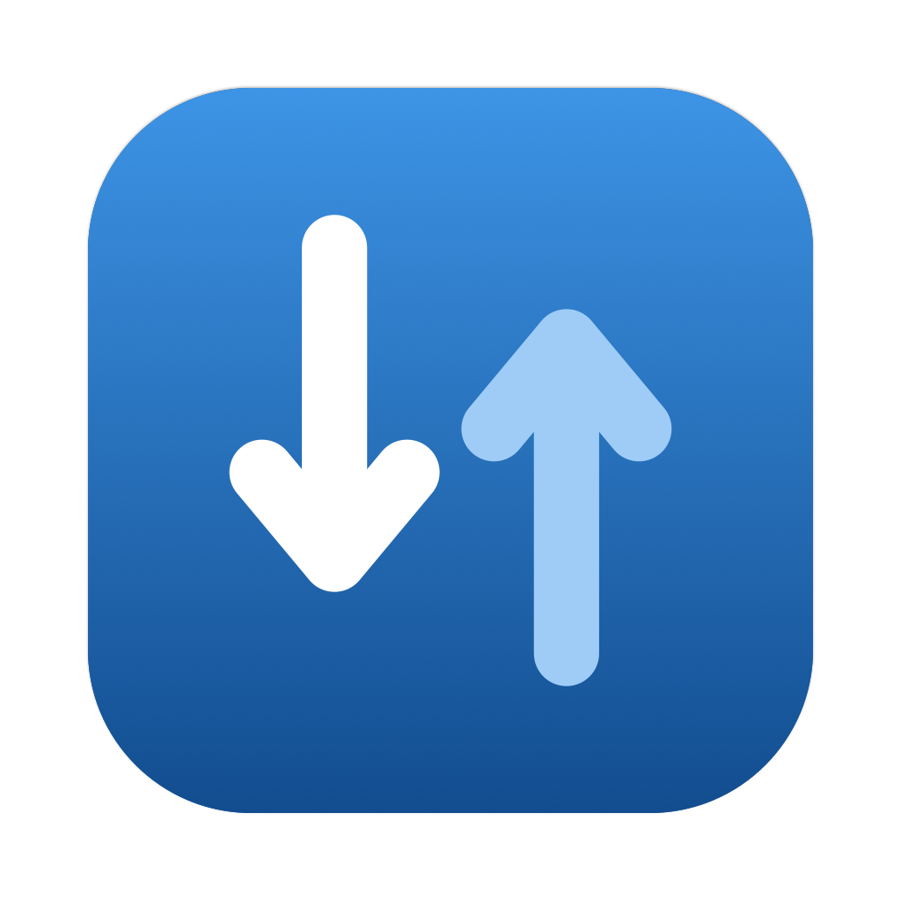

<p align="center"></p>

<h1 align="center">ByteMeter</h1>

<p align="center">A tiny macOS menu bar app that shows how much internet data you've used, and which apps used it.</p>

## Features

- **Live total in the menu bar:** `⇅ 1.84 GB`, or `⇅ 37%` once you set a quota.
- **Top 10 apps:** ranked list with each app's icon, name, a download/upload bar and its live speed.
- **Per-app details:** bundle ID, location, the processes that made the traffic (with PIDs), and the servers it talked to (reverse DNS hostname, IP, protocol, port).
- **Correct attribution:** helper processes are folded into their app (Chrome Helper → Google Chrome, WebKit networking → Safari, XPC services → the app that launched them).
- **Monthly quota:** set a cap in GB to see the percentage used and how much is left.
- **Monthly auto-reset:** pick your billing day (1–31) and the counters reset automatically. In shorter months the reset happens on the last day.
- **Manual reset** at any time.
- Local network traffic (LAN, Bonjour, AirDrop) is excluded, so only internet usage is counted.
- Launches at login (can be turned off in Settings). No network access of its own, no analytics.

## Install

1. Download `ByteMeter-x.y.dmg` from the [Releases](../../releases) page.
2. Open it and drag **ByteMeter** to **Applications**.
3. Open ByteMeter from Applications.

ByteMeter is not signed with an Apple Developer ID, so the first launch is blocked by Gatekeeper. To allow it:

- Open **System Settings → Privacy & Security**, scroll down and click **Open Anyway** next to the ByteMeter message, **or**
- run this once in Terminal:

  ```bash
  xattr -dr com.apple.quarantine /Applications/ByteMeter.app
  ```

Requires macOS 13 Ventura or later. Universal binary (Apple Silicon and Intel).

## Build from source

Requires Xcode command line tools (Swift 5.9+).

```bash
git clone https://github.com/hebelemece/ByteMeter.git
cd ByteMeter
./build.sh            # builds build/ByteMeter.app
./build.sh install    # builds, copies to /Applications and launches
./build.sh dmg        # builds build/ByteMeter-<version>.dmg
```

The app icon is drawn by `Icon/make_icon.swift` (`swift Icon/make_icon.swift Icon` regenerates the PNGs, then `iconutil` builds `AppIcon.icns`).

## How it works

ByteMeter runs Apple's built-in `/usr/bin/nettop` as a continuous stream (one sample per second) and reads per-process and per-connection byte counters from it. No root privileges, kernel extensions or network filters are needed.

- Each process is mapped to an app via its executable path (outermost `.app` bundle), then via macOS's "responsible process" for helpers and XPC services, then via a list of known system services.
- Counters are turned into deltas; processes that started between samples are counted in full so short downloads (e.g. `curl`) aren't missed.
- Connections to local, link-local and multicast addresses are subtracted.
- Data is saved to `~/Library/Application Support/ByteMeter/usage-v2.json` every 30 seconds and on quit.

### Limitations

- Totals count payload bytes seen by the network stack. Your carrier also counts protocol headers, so its number is typically a few percent (up to ~10%) higher.
- `nsurlsessiond` (background downloads) works on behalf of many apps; macOS doesn't expose which one, so it shows up as its own entry. The server names in its details usually reveal the service.
- Traffic from other user accounts on the same Mac isn't visible.

## License

[MIT](LICENSE)
